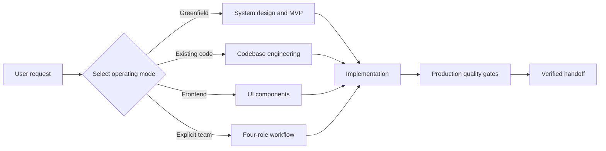
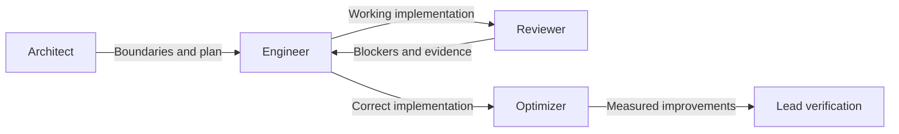

<div align="center">

# Production App Engineer

**A production-grade Codex skill that turns product ideas and existing codebases into reliable, scalable software.**


[中文说明](README.zh-CN.md) · [Skill entrypoint](SKILL.md) · [Quality gates](references/quality-gates.md)

</div>

## What it does

`production-app-engineer` gives Codex a disciplined senior-engineering workflow for greenfield products and existing systems. It connects architecture to real files, schemas, endpoints, UI states, tests, operational safeguards, and measurable outcomes.

It is intentionally opinionated about engineering quality, but not about your framework. The skill preserves the user's stack when one exists and defaults to the smallest viable architecture when starting from zero.

## Install in 30 seconds

```bash
git clone https://github.com/nbnb9/production-app-engineer-skill.git \
  "${CODEX_HOME:-$HOME/.codex}/skills/production-app-engineer"
```

Open a new Codex session so the skill is discovered, then invoke it explicitly:

```text
Use $production-app-engineer to design and implement a production-ready MVP for my product.
```

## Choose your workflow

| Need | What the skill produces |
| --- | --- |
| Build an application from zero | Architecture, file structure, schema, APIs, UI, deployment shape, tests, and a runnable vertical slice |
| Design and implement a system | Components, data flow, failure handling, cache/queue decisions, migrations, and production code |
| Understand an unknown codebase | Runtime map, module boundaries, data ownership, principal flows, and evidence-backed risks |
| Refactor without changing behavior | Characterization tests, safe seams, incremental migration plan, compatibility checks, and improved code |
| Debug a production issue | Reproduction, causal chain, violated invariant, root cause, regression test, and robust fix |
| Improve performance | Baseline, bottleneck evidence, focused optimization, before/after measurement, and tradeoffs |
| Build reusable UI | Component boundaries, typed props, state matrix, accessibility, responsive behavior, tests, and usage examples |
| Run a four-role workflow | Architect design, engineer implementation, reviewer findings, optimizer measurements, and lead integration |

## How it works

The entrypoint loads only the guidance needed for the current request. This keeps the working context focused without dropping production safeguards.



### Engineering principles

- **Vertical slices over scaffolding:** prove one complete user journey before expanding.
- **Evidence over confidence:** use tests, traces, query plans, profiles, and benchmarks.
- **Behavior before structure:** protect observable contracts before refactoring internals.
- **Measured scale:** introduce caches, queues, and service splits only for concrete pressure.
- **Trust-boundary validation:** make authorization, validation, errors, and ownership explicit.
- **Honest completion:** never translate “not tested” into “production-ready.”

## Four-role mode

Multi-agent execution is opt-in. When the user explicitly requests it, the skill coordinates four focused roles and keeps the lead responsible for integration:



```text
Use $production-app-engineer with the architect, engineer, reviewer, and optimizer workflow.
```

## More examples

```text
Use $production-app-engineer to understand this repository, map its data flow,
identify the highest-risk structural problems, and refactor it without changing behavior.
```

```text
Use $production-app-engineer to investigate this production bug. Reproduce it,
find the violated invariant, implement the root-cause fix, and add a regression test.
```

```text
Use $production-app-engineer to profile this page, reduce unnecessary renders,
and report the before/after measurements without changing user-visible behavior.
```

## Repository map

```text
production-app-engineer/
├── SKILL.md                              # Routing and shared engineering contract
├── agents/
│   └── openai.yaml                       # Codex UI metadata
└── references/
    ├── system-design-and-mvp.md           # Greenfield architecture and implementation
    ├── codebase-engineering.md            # Discovery, refactoring, debugging, performance
    ├── ui-components.md                   # Accessible production UI components
    ├── four-role-workflow.md              # Explicit multi-agent coordination
    └── quality-gates.md                   # Correctness, security, reliability, delivery
```

## Design boundaries

- No framework, language, database, or cloud provider is required.
- No external runtime dependency is needed to load the skill.
- Review and diagnosis requests stay read-only unless implementation is requested.
- Refactors preserve observable behavior unless a compatibility change is explicit.
- Multi-agent execution starts only when the user asks for delegation or the four-role workflow.
- Production claims require proportional verification and clearly reported gaps.

## License

Released under the [MIT License](LICENSE). Copyright (c) 2026 nbnb9.

## Validation

The skill is checked with Codex's bundled `quick_validate.py` validator. The entrypoint, UI metadata, and referenced guidance files are included in this repository with no unfinished placeholders.

---

<div align="center">

Built for teams that want an MVP to be **small today and evolvable tomorrow**.

</div>
