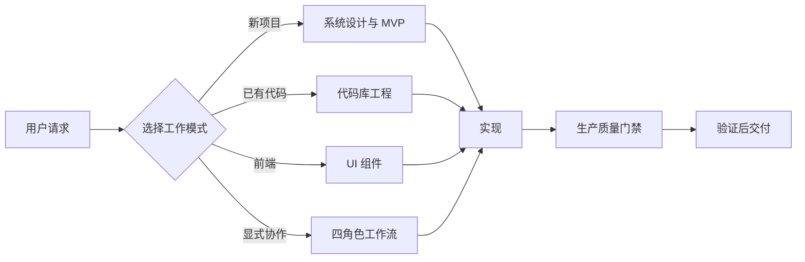
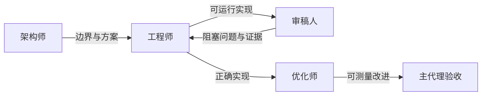

<div align="center">

# Production App Engineer

**面向 Codex 的生产级工程 Skill：把产品想法和现有代码库转化为可靠、可扩展的软件。**


[English](README.md) · [Skill 入口](SKILL.md) · [质量门禁](references/quality-gates.md)

</div>

## 它能做什么

`production-app-engineer` 为新产品和已有系统提供一套资深工程师级工作流。它不会停留在泛泛的架构建议，而是把设计落实到真实文件、数据库模式、API、UI 状态、测试、运维保障和可测量结果。

它对工程质量有明确要求，但不强制指定框架。面对已有项目时保留用户的技术栈；从零开始时，默认选择能够满足需求的最小可行架构。

## 30 秒安装

```bash
git clone https://github.com/nbnb9/production-app-engineer-skill.git \
  "${CODEX_HOME:-$HOME/.codex}/skills/production-app-engineer"
```

打开新的 Codex 会话，使 Skill 被发现，然后显式调用：

```text
使用 $production-app-engineer 从零设计并实现一个可投入生产的 MVP。
```

## 选择工作模式

| 你的需求 | Skill 交付内容 |
| --- | --- |
| 从零构建完整应用 | 架构、文件结构、数据库、API、UI、部署形态、测试和可运行的垂直切片 |
| 系统设计并实现 | 组件边界、数据流、失败处理、缓存/队列决策、迁移和生产代码 |
| 理解未知代码库 | 运行时地图、模块边界、数据归属、关键链路和有证据的问题清单 |
| 行为不变的重构 | 特征测试、安全切入点、渐进迁移、兼容性检查和改进代码 |
| 调查生产 Bug | 稳定复现、因果链、被破坏的不变量、根因、回归测试和稳健修复 |
| 性能优化 | 基线、瓶颈证据、定向优化、前后测量和权衡说明 |
| 构建可复用 UI | 组件边界、类型化 Props、状态矩阵、可访问性、响应式、测试和示例 |
| 四角色协作 | 架构师设计、工程师实现、审稿人反馈、优化师测量和主代理集成 |

## 工作原理

入口只加载当前任务需要的参考指南，在控制上下文体积的同时保留生产质量要求。



### 工程原则

- **垂直切片优先：** 先打通一条完整用户链路，再扩展功能。
- **证据优先：** 使用测试、追踪、查询计划、性能剖析和基准数据。
- **行为优先：** 重构内部结构前，先保护外部可观察契约。
- **按测量扩展：** 只在真实压力下引入缓存、队列或服务拆分。
- **保护信任边界：** 明确处理授权、验证、错误和数据归属。
- **诚实交付：** 未测试不等于通过，能运行不等于生产就绪。

## 四角色模式

多代理执行是显式启用的。只有用户要求时，Skill 才会协调四个专注角色，并由主代理负责最终集成：



```text
使用 $production-app-engineer，并启用架构师、工程师、审稿人、优化师四角色工作流。
```

## 更多示例

```text
使用 $production-app-engineer 理解这个代码库，梳理数据流，找出风险最高的结构问题，
并在行为保持不变的前提下完成重构。
```

```text
使用 $production-app-engineer 调查这个生产 Bug：稳定复现、定位被破坏的不变量、
修复根因，并添加能够覆盖原始触发条件的回归测试。
```

```text
使用 $production-app-engineer 分析这个页面的性能，减少不必要的渲染，
在不改变用户行为的前提下报告优化前后的测量数据。
```

## 仓库结构

```text
production-app-engineer/
├── SKILL.md                              # 路由与共享工程契约
├── agents/
│   └── openai.yaml                       # Codex UI 元数据
└── references/
    ├── system-design-and-mvp.md           # 新项目架构与实现
    ├── codebase-engineering.md            # 理解、重构、调试、性能
    ├── ui-components.md                   # 可访问的生产级 UI 组件
    ├── four-role-workflow.md              # 显式多代理协作
    └── quality-gates.md                   # 正确性、安全、可靠性、交付
```

## 设计边界

- 不绑定框架、编程语言、数据库或云厂商。
- 加载 Skill 不需要额外运行时依赖。
- 代码审查和问题诊断默认保持只读，除非用户要求实现。
- 重构默认保持可观察行为不变，兼容性变化必须明确说明。
- 只有用户要求委派或四角色工作流时，才会启动多代理执行。
- “生产就绪”必须有与风险相称的验证，并明确报告缺失项。

## 校验状态

该 Skill 已通过 Codex 内置的 `quick_validate.py` 校验。仓库包含完整入口、UI 元数据和全部参考指南，不含未完成占位符。

---

<div align="center">

为希望 MVP **今天足够小、明天可演进** 的团队而设计。

</div>
